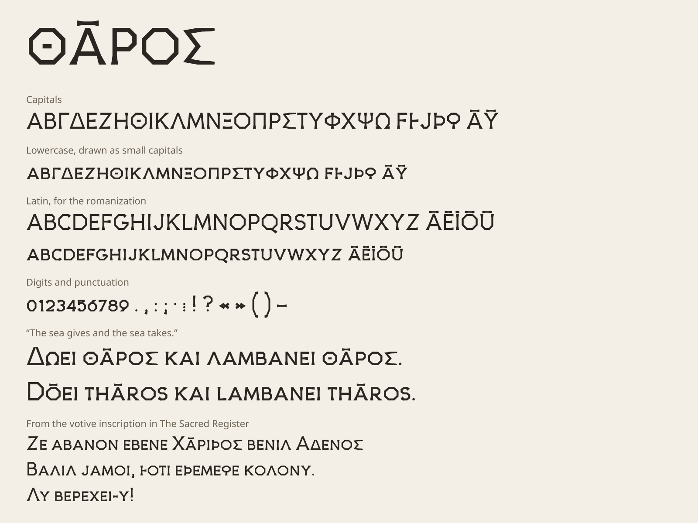

# The Stele Typeface

[← Overview](../README.md)

**Tharaic Stele** is a typeface for the [Tharaic alphabet](phonology.md), in the style of a carved inscription: every stroke is a straight cut, curves included, and strokes widen into a wedge at their ends, as a chisel leaves them. It covers every letter of the alphabet, including the extra letters that most fonts lack or draw unevenly, and the Latin letters of the romanization, so a whole text appears in one style.



Files:

| File | Use |
|------|-----|
| [`font/TharaicStele.ttf`](../font/TharaicStele.ttf) | Install on a computer |
| [`font/TharaicStele.woff2`](../font/TharaicStele.woff2) | Use on a web page |
| [`tools/build_font.py`](../tools/build_font.py) | The source: every letter is drawn there |

---

## Design

**One alphabet.** Inscriptions have no lowercase, so the font has none either: **lowercase letters are drawn as small capitals**. Ordinary text, written in lowercase as in these docs, comes out as an inscription with larger initials (*Δωει θᾱρος* → ΔΩΕΙ ΘᾹΡΟΣ with a full-height Δ). Final *ς* has the same form as *σ*.

**Strokes.** Every letter is a centreline of straight cuts, made with one width of stroke:

| | Height | Stroke |
|---|---|---|
| Capitals | 700 | 84 |
| Small capitals, digits | 510 | 76 |

The units are thousandths of the font size. Diagonal strokes are cut flat where they meet a line, so *Α Λ Δ* have flat tops.

**No curves.** A chisel cuts straight, so there are no true curves: round letters are built on a **diamond** of four cuts instead: *Ο* and *Q*, *Θ* (with a cross), *Φ* (on a stem through it), *Ϙ* (on a short stem) and *Ω* (over a bar on the baseline). *C* is a wide ⟨ of two cuts, about 100° open, and *G* adds an upright spur. The few curves left, in *S* and the digits (*0* is a hexagon, to tell it from *O*), are broken into straight cuts, one for each 60° of their turn. Bowls are pointed (see below).

**Flares.** Every free end of a stroke widens in a straight-sided wedge over its last two stroke-widths, by almost a third of the stroke on each side, as the chisel opens the cut at its end. Where a stem stands on the baseline the flare makes a broad foot; where a bar along the top or bottom line ends (*Ε Τ Γ*), it makes a spur pointing away from the line. Ends that join another stroke stay plain, and so does the short floating bar of *Θ*.

**Archaic forms.** Where an older inscriptional form exists and stays readable, the font uses it, as stone-cutters did before the Classical alphabet settled:

| Letter | Archaic form |
|--------|--------------|
| **Α** | The crossbar slopes down to the right |
| **Β Ρ Ϸ** | Pointed bowls: two cuts meeting at a point |
| **Ε** | The arms slope down from the stem, as in Phoenician *he* |
| **Ζ** | Two bars joined by a stem (⌶), as in Phoenician *zayin*. It differs from *Ι* by its bars |
| **Θ** | A cross in a diamond, full height so its four counters stay open |
| **Ξ** | A stem through the three bars |
| **Ο** | A diamond of four cuts, smaller than the other letters and centred on the middle. Latin *O* shares it |
| **Π** | The right leg is short |
| **Σ Μ** | Splayed outer strokes |
| **Ψ** | A trident of straight cuts |

The other letters keep the forms everyone knows. *Ω* was a late letter even in Greek; here it is a diamond standing over a bar on the baseline.

**The extra letters** are drawn after their Unicode forms, in the same strokes as the rest:

| Letter | Form in the font |
|--------|------------------|
| **Ϝ ϝ** digamma | F: stem, top bar and a shorter middle bar |
| **Ͱ ͱ** heta | The left half of Η: a stem and half a crossbar |
| **Ϳ ϳ** yot | An upside-down Λ with a short left leg: two cuts. Unlike *V*, its legs are unequal. Latin *J* shares it |
| **Ϸ ϸ** sho | Þ: a stem with a bowl at mid-height. *Ρ* has its bowl at the top |
| **Ϙ ϙ** koppa | A diamond on a short stem, standing on the baseline. *Φ* has its stem through the diamond |
| **ᾱ ῡ**, **Ᾱ Ῡ** | A macron centred over the letter. A separate combining macron (U+0304) is placed the same way |

**Latin letters** are there for the romanization, with the long vowels *ā ē ī ō ū*. Like the Greek ones, lowercase is drawn as small capitals. Letters with the same shape in both alphabets share one drawing, archaic forms included, much as early Latin inscriptions borrowed them (*A* is *Α*, *P* is *Ρ*, *F* is *Ϝ*, *J* is *Ϳ*); *C D G L Q R S V W Z* are drawn on their own in the same strokes: *C* is a wide ⟨, *G* the same with a spur, *Q* the diamond of *O* with a tail, and *D*, *R* have pointed bowls. **U is written V**, as in Roman inscriptions: *u* and *v*, *ū* and a V with a macron, look the same and are told apart by context. Only the drawing is shared, so the text itself still holds *u*, and copying or searching it works as before. *Z* keeps its later zigzag form, since the archaic *Ζ* would read as *I*. Hebrew transliteration marks such as *ḥ* and *ṣ* are not included.

**Digits and punctuation** cover what the docs use: digits at small-capital height, *. , : ; · ! ? ( ) [ ] - – — « »* and quotation marks, the Greek question mark (*;*) and raised dot (*·*), and the inscriptional word divider *⁝*. Punctuation and alphabetic numerals are still to be designed for the script itself ([Roadmap](roadmap.md#later)); the font will follow that work.

**Spacing.** Side bearings depend on the shape of each side (stem, round, open or diagonal), and a small kerning table closes the gaps between pairs like *ΤΑ*, *ΑΥ* and *ΓΑ*, in capitals and small capitals.

---

## Using it

On a computer, install `TharaicStele.ttf` and choose *Tharaic Stele* in any program. On a web page:

```css
@font-face {
  font-family: "Tharaic Stele";
  src: url("TharaicStele.woff2") format("woff2");
}
.tharaic { font-family: "Tharaic Stele", serif; }
```

The font has no Greek accents or breathings, which Tharaic does not write, so quotations from Classical Greek (*ὀργισθείς*) fall back to another font.

## Changing it

Each letter is a short function in `tools/build_font.py`. Edit it and rebuild:

```bash
pip install fonttools skia-pathops brotli
python3 tools/build_font.py
```

This writes the two font files and this page's specimen. The build is reproducible: the same source gives the same files.
